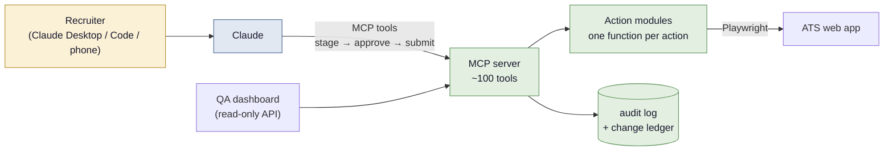

# Action Agent

The QA tool finds problems. The action agent fixes them, and then kept growing into
the hands of the whole recruiting team.

Recruiting runs on an applicant tracking system (Hireology) that has no write API.
Every change, whether fixing a job posting, declining a candidate, sending an offer
or adding a hiring manager, is a click-through in the vendor's web app. The action agent is a
Python + Playwright agent that drives that web app the way a person would, exposed
to Claude as an MCP server so a recruiter can ask for the work in plain English and
approve each step.

> Case study only. The code is private (it runs against a real employer's live
> account and candidate data). The design is real; the names here follow the same
> fictional brand as the rest of this repo. [`stage_submit_demo.py`](stage_submit_demo.py)
> is a runnable, stdlib-only version of the safety pattern described below.

---

## What it does today

| Area | Examples |
|---|---|
| Job postings | Fix the defects the QA tool flags on live postings; bulk clean-ups across ~1,000 job templates; create a job (left Pending for review); close a job |
| Candidates | Text replies, interview requests, declines, rejection letters, offers, moving applicants between jobs |
| Hiring setup | Prescreen surveys, application forms, email/text templates, rejection-reason lists, staff user access |
| Reporting | A daily open-jobs file for an operations dashboard, a monthly applicants-vs-spend lookback, a full export of the account's hiring configuration as JSON |

Measured from the agent's own audit log, using conservative per-task minute
estimates the recruiting lead signed off on: about **1,100 posting fixes** and
**95 hours of manual admin work** saved so far, and climbing.

---

## Architecture

**Actions are discrete, not bundled.** Each thing the agent can do is one function
in the right module (`jobs.create_pending_job()`, `candidates.stage_decline()`,
`offers.stage_offer()`). Scripts and MCP tools compose actions; they never contain
action logic. Adding a capability means adding a verb, not a script.

**Five layers, so judgment lives in text, not code:**

1. **Tools**: verbs only, no judgment.
2. **Rules**: hard safety rails every client gets (approval, opt-outs, PII).
3. **Playbooks**: one Markdown file per recurring task: what to read, what to ask, which default to propose.
4. **Standing decisions**: the recruiting lead's recurring calls, with the reasoning, kept where voice and chat sessions can read them too.
5. **Learning loop**: when no playbook fits, the agent proposes an approach, asks, and offers to save the answer as a new playbook.

A wrong outcome gets fixed in a playbook or a decision. Python changes only for a
missing verb or a missing safety rail.

---

## Safety design

The agent writes to a system where real candidates read what it sends. The design
assumes the model will sometimes be wrong and makes that cheap:

- **Stage, then submit.** Every write tool fills the real form, screenshots it and
  returns a `staged_id`. Nothing is sent. The human sees the exact text, and only
  then does the submit tool press the final button. Submit refuses if the form no
  longer holds what was approved. See [`stage_submit_demo.py`](stage_submit_demo.py).
- **One item, one approval.** One staged item at a time; any other call cancels it.
  An OK never carries over to the next message. The one exception (bulk close-out of
  old applicants with the standard letter) is a written standing approval with hard
  limits in code: last 30 days only, never anyone who reached an interview.
- **Verify before save.** Bulk posting fixers re-read the live page at save time,
  confirm the posting is still public and the flagged pattern is still there, and
  skip anything where visible text would change. Each fix writes a before/after
  snapshot so it can be reverted.
- **A change ledger.** Approved configuration changes are written to a JSON ledger
  *before* they are applied, with everything needed to undo them.
- **Hosted, but gated.** A copy runs on Fly.io so work continues when the laptop is
  off. Two bearer tokens (read-only and write) are checked against the request body,
  so a generic `call_tool` can't smuggle a write through a read token. Only writes the
  owner has explicitly cleared run headless. A "baton" makes sure the laptop and the
  cloud copy never log in to the vendor at the same time.
- **Docs are tested.** An offline test fails when a tool or parameter is missing
  from the tool catalogue, so the docs Claude reads can't drift from the code.

---

## Things I learned building it

- **Read the app's own JSON feeds.** A crawl that opened every job page took long
  enough to stall on a small cloud machine. The same data comes from the JSON
  the vendor's own Jobs list calls, reusing the logged-in page's auth, in about a minute.
- **The UI is the spec.** Drag-and-drop-only reordering, checkboxes hidden behind
  styled labels, a confirm pop-up that silently blocks a save when a survey is shared by
  several jobs: each became a mapped, documented gotcha in a site atlas the agent
  reads before writing a new action, instead of fresh live recon.
- **Hot reload beats restarts.** Tool code reloads before the next call when nothing
  is staged, so a missing verb gets built and used in the same conversation.

## Tech stack

Python 3.13, Playwright (Chromium), the MCP Python SDK (stdio locally, streamable
HTTP on Fly.io), TOTP for the service account's MFA, the Anthropic API for the one
fixer that is meant to change wording (spelling and grammar, bounded by a text-diff
guard), GitHub Actions for deploy-on-push.
